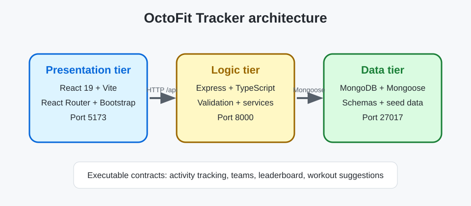

# OctoFit Tracker architecture

OctoFit Tracker is a three-tier application for a school fitness program. The starter code includes API contracts and intentionally incomplete implementation points so you can use GitHub Copilot agent mode in a test-driven loop.

## Tier boundaries

- **Presentation tier**: React 19, Vite, React Router, Bootstrap, and a shared API client in `octofit-tracker/frontend/src`.
- **Logic tier**: Express and TypeScript routes/services in `octofit-tracker/backend/src` expose `/api/*` behavior on port `8000`.
- **Data tier**: Mongoose models and seed data in `octofit-tracker/backend/src/models` and `src/scripts/seed.ts` persist to MongoDB on port `27017`.

## Ports and environment rules

- MongoDB: `27017`
- Express API: `8000`
- Vite frontend: `5173`
- The browser calls relative `/api` paths. Vite proxies them to `http://localhost:8000`, so the unauthenticated API port stays private in Codespaces. `VITE_API_BASE_URL` can override the base URL.

## API contract

| Capability | Method and path | Expected behavior |
| --- | --- | --- |
| Activity tracking | `GET /api/activities`, `POST /api/activities` | List and create valid activity records. POST accepts `userId`, `teamId`, `type`, and `minutes`; `userId` and `teamId` must be well-formed IDs for an existing user and team; otherwise respond with a deliberate 4xx (never a 500 from a cast error). A created activity stores the submitted `user`, `team`, `type`, and `minutes` plus computed `points` and `occurredAt`. |
| Teams | `GET /api/teams`, `POST /api/teams` | List and create teams with members. Created and listed teams keep the submitted `name` and `mascot`. Reject a team without a name with `400`. |
| Leaderboard | `GET /api/leaderboard` | Return teams ordered by the sum of their activity points, highest first. Each entry has `teamName`, `totalPoints`, and a 1-based `rank`. |
| Workout suggestions | `GET /api/workouts/suggestions/:userEmail` | Recommend workouts from recent activity patterns for the matching seeded user's email address. The first suggestion's `focus` matches that user's goal or recent activity, with a `reason` explaining why. An email with no matching user returns a deliberate 4xx (for example, `404`). |

## Implementation decisions

The following decisions establish the implementation plan.

- Presentation tier decision: Keep route-specific rendering in the React frontend and API calls in the shared client. Each data-backed route must expose accessible loading, empty, and error states while continuing to use relative `/api` paths through the Vite proxy.
- Logic tier decision: Keep HTTP handling and request validation in the Express API, with business behavior in focused route/service code. Return deliberate 4xx responses for invalid or missing resources rather than allowing malformed input to become a server error.
- Data tier decision: Keep persistence and field constraints in Mongoose models. Preserve referential consistency between users, teams, and activities, and keep seeding repeatable without deleting or overwriting unrelated records.
- Activity tracking approach: Validate activity type, positive minutes, and well-formed IDs that resolve to an existing user and team before creating a record. Persist the referenced user/team, submitted activity details, computed points, and occurrence time; list activities from persisted records.
- Team management approach: Require a team name, retain the submitted name and mascot, and store members as user references. Support listing and creating teams without dropping member relationships.
- Leaderboard approach: Sum persisted activity points per team, sort teams by descending total, and return each team name, total points, and a 1-based rank.
- Workout suggestions approach: Find the user by email, use their goal and recent activities to select matching workouts, and include a concise reason for the first recommendation. Return a 4xx response when no user matches.

## Test plan

Run the focused contract tests after each tier, then run both builds. The backend data and API contract tests use `mongodb-memory-server` and create an isolated MongoDB instance; the local MongoDB service is not their test database.

- Data tier: `npm run test:data --prefix octofit-tracker/backend` — checks model constraints, references/defaults, and repeatable, non-destructive seed behavior. Failures point to persistence/schema or seed-contract regressions.
- Logic tier: `npm run test:api --prefix octofit-tracker/backend` — checks activity and team requests, leaderboard aggregation/ranking, and workout recommendations including invalid input. Failures point to API behavior or its use of the models.
- Presentation tier: `npm test --prefix octofit-tracker/frontend` — checks API-backed rendering and accessible loading, empty, and error states for each route. Failures point to frontend request handling or user-visible behavior.
- Backend build: `npm run build --prefix octofit-tracker/backend` — runs the TypeScript compiler; failures indicate backend type errors.
- Frontend build: `npm run build --prefix octofit-tracker/frontend` — runs the TypeScript compiler and Vite production build; failures indicate frontend type errors or bundling issues.
